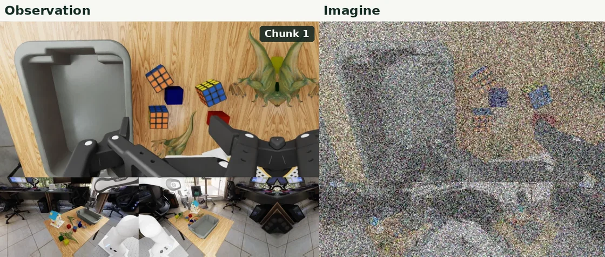

<h1 align="center">Sparse-WAM: Accelerating World Action Models<br>via Action-Guided Sparse Imagination</h1>

<p align="center"><strong>Imagine less. Act with focus.</strong></p>

<p align="center">
  Xinling Xie<sup>1,2,*,†</sup>, Haodong Wang<sup>2,*</sup>, Jiazhi Mi<sup>2</sup>, Zhiming Liu<sup>3</sup>, Zicong Hong<sup>4</sup>,<br>
  Xiaoyi Pang<sup>2</sup>, Qianli Liu<sup>2</sup>, Yangjia Hu<sup>2</sup>, Ying Chen<sup>2</sup>, Zhengyang Yan<sup>2</sup>, Song Guo<sup>2</sup>
</p>

<p align="center">
  <sup>1</sup> NJU &nbsp;·&nbsp; <sup>2</sup> HKUST &nbsp;·&nbsp; <sup>3</sup> HIT &nbsp;·&nbsp; <sup>4</sup> EPFL<br>
  <sup>*</sup> Equal contribution &nbsp;·&nbsp; <sup>†</sup> Work done during an internship at HKUST
</p>

<p align="center">
  <a href="https://rockylix.github.io/Sparse-WAM.github.io/"></a>
  <a href="https://arxiv.org/abs/2609.38984"></a>
  <a href="https://huggingface.co/nvidia/Cosmos3-Edge-Policy-DROID"></a>
  <a href="docs/rtx4090.md"></a>
</p>

<p align="center">
  
  
  
</p>

<p align="center">
  <a href="#overview">Overview</a> · <a href="#method">Method</a> · <a href="#main-results">Results</a> · <a href="#installation">Installation</a> · <a href="#example">Example</a> · <a href="#citation">Citation</a>
</p>

## Overview

Sparse-WAM speeds up world action models without retraining. The demo pairs the robot’s observations (left) with the future frames it imagines (right) as it puts the lizards in the bin.

[](examples/image/edge-visual.mp4 "Open the full-resolution video")

## Method

**Sparse-WAM** uses a single full conditional pass at the start of each action chunk
to measure how strongly action tokens attend to different regions of each future frame.
It selects action-relevant tokens for each frame and spatial anchors shared across frames.
Subsequent sparse passes recompute only the selected future tokens and reuse cached
predictions for the remaining regions. Action predictions are updated at every denoising step.

We designed **Pilot**, our inference engine, alongside Sparse-WAM to keep sparse execution
efficient. Pilot scores tokens using statistics from the full attention pass, reuses the
selection across denoising steps, and packs the retained tokens into a shorter sequence
for the Transformer.

[](examples/image/architecture.pdf)

## Main Results

Results from [Tables 1–2 of the paper](https://arxiv.org/pdf/2609.38984v1#page=7),
measured on an NVIDIA RTX 4090:

| Backbone / benchmark | Dense success rate | Sparse-WAM success rate | Speedup | FLOPs / dense |
|---|---:|---:|---:|---:|
| **Cosmos3-Edge / RoboLab-120** | 22.90% | **23.00%** | **1.85×** | 60.73% |
| FastWAM-Joint / LIBERO | 98.75% | 98.45% | **1.98×** | 49.65% |
| Cosmos3-Nano-Policy / RoboLab-120 | 36.75% | 35.50% | **1.81×** | 59.78% |

Speedups compare optimized Sparse-WAM with dense eager inference and include
execution optimizations. FLOPs are relative to each dense backbone.

### Robustness on LIBERO-Plus

Robust experiments on LIBERO-Plus with Fastwam-Joint.

| Method | Average success | Latency per action chunk | Speedup |
|---|---:|---:|---:|
| FastWAM (action-only) | 51.96% | 90.1 ms | 4.79× |
| FastWAM-Joint (dense) | 70.89% | 431.7 ms | 1.00× |
| **FastWAM-Joint + Sparse-WAM** | **70.00%** | **221.0 ms** | **1.95×** |

### Model support

- [x] [Cosmos3 Edge on RTX 4090](docs/rtx4090.md)
- [x] [FastWAM-Joint on LIBERO (offline, RTX 4090)](docs/fastwam_joint.md)
- [ ] Cosmos3 Nano Policy

## News

- **[2026.11.25]** Initial release with **Cosmos3 Edge** support.

## Installation

Use Linux x86_64, an NVIDIA RTX 4090 and a CUDA 13-compatible NVIDIA driver.
Install [uv](https://docs.astral.sh/uv/getting-started/installation/); Python 3.13
and the inference dependencies are managed by the project lockfile.

```bash
git clone https://github.com/Rockylix/Sparse-WAM.git
cd Sparse-WAM
uv sync --locked --extra edge
source .venv/bin/activate
```

Keep the complete source checkout: the vendored runtimes are required for
inference. The commands above install Edge. For FastWAM-Joint, use
`uv sync --locked --extra fastwam-joint` and follow the [LIBERO setup and Python example](docs/fastwam_joint.md).

## Example

Prepare the official Edge DROID checkpoint and a recorded observation, then run
Sparse-WAM offline:

```bash
python tools/prepare_smoke.py
python examples/infer_edge.py \
  --checkpoint-path checkpoints/edge \
  --observation outputs/smoke/observation.npz \
  --native-config configs/smoke_edge.json \
  --output outputs/example/edge_action.npz
```

Model downloads may require Hugging Face access. The example saves predicted
`[32, 8]` actions and a JSON run summary. Use a new output path for subsequent runs.
For the dense control, add `--mode dense --execution eager`.

[Python API](docs/api.md) · [Paired validation](docs/validation.md) · [Method details](docs/method.md)

## Citation

If you find Sparse-WAM useful in your research, please cite:

```bibtex
@misc{xie2026sparsewamacceleratingworldaction,
  title={Sparse-WAM: Accelerating World Action Models via Action-Guided Sparse Imagination},
  author={Xinling Xie and Haodong Wang and Jiazhi Mi and Zhiming Liu and Zicong Hong and Xiaoyi Pang and Qianli Liu and Yangjia Hu and Ying Chen and Zhengyang Yan and Song Guo},
  year={2026},
  url={https://arxiv.org/abs/2609.38984}
}
```
