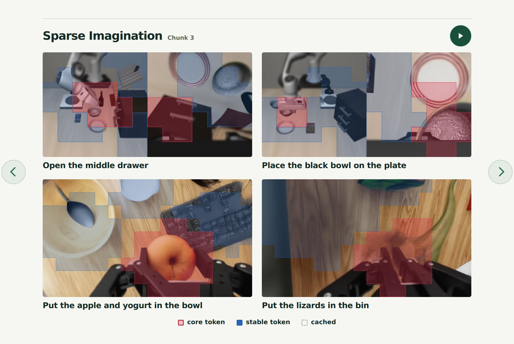
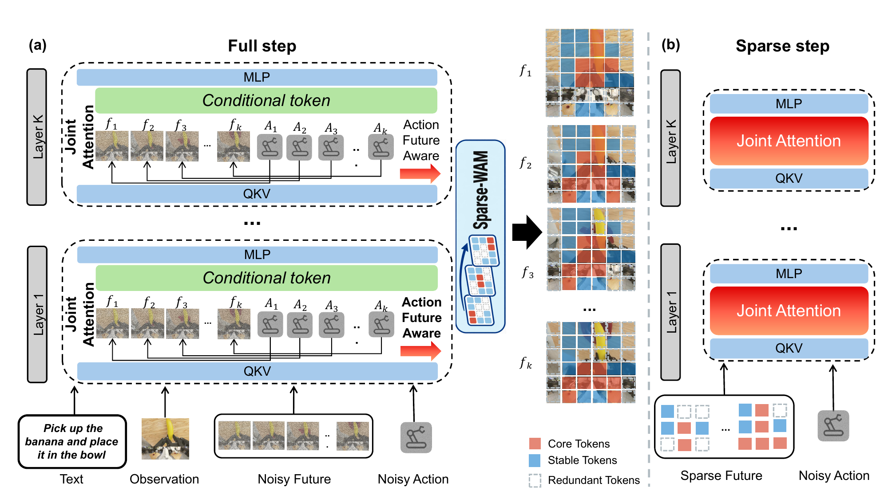

# Sparse-WAM: Accelerating World Action Models via Action-Guided Sparse Imagination

Training-free, action-guided sparse inference for World Action Models.

[Paper](https://arxiv.org/abs/2609.38984) · [Website](https://rockylix.github.io/Sparse-WAM.github.io/) · [BibTeX](#citation)

[](https://rockylix.github.io/Sparse-WAM.github.io/)

*Click the preview to watch sparse imagination on the project website.*

## What is Sparse-WAM?

Sparse-WAM accelerates world action models by using action attention to select
which future-vision tokens to compute. It combines frame-specific **Core tokens**
with shared **spatial anchors**, preserving task-relevant regions and context
without retraining the model.

**Pilot**, our sparse inference engine, keeps selection and execution overhead low
through lightweight attention scoring, cross-step selection reuse and compact
Transformer execution. Cached predictions update omitted visual regions while
action predictions are recomputed at every denoising step.

[](examples/image/architecture.pdf)

### Results

Results from [Tables 1–2 of the paper](https://arxiv.org/pdf/2609.38984v1#page=7),
measured on an NVIDIA RTX 4090:

| Backbone / benchmark | Dense success rate | Sparse-WAM success rate | Speedup | FLOPs / dense |
|---|---:|---:|---:|---:|
| **Cosmos3-Edge / RoboLab-120** | 22.90% | **23.00%** | **1.85×** | 60.73% |
| FastWAM-Joint / LIBERO | 98.75% | 98.45% | **1.98×** | 49.65% |
| Cosmos3-Nano-Policy / RoboLab-120 | 36.75% | 35.50% | **1.81×** | 59.78% |

Speedups compare optimized Sparse-WAM with dense eager inference and include
execution optimizations. FLOPs are relative to each dense backbone. The
installation and example below target **Cosmos3 Edge**.

## News

- **[2026.11.25]** Initial release with **Cosmos3 Edge** support.

## Installation

Use Linux x86_64, an NVIDIA RTX 4090 and a CUDA 13-compatible NVIDIA driver.
Install [uv](https://docs.astral.sh/uv/getting-started/installation/); Python 3.13
and the inference dependencies are managed by the project lockfile.

```bash
git clone https://github.com/Rockylix/Sparse-WAM.git
cd Sparse-WAM
uv sync --locked --extra edge
source .venv/bin/activate
```

Keep the complete source checkout: the vendored runtimes are required for
inference. See the [RTX 4090 guide](docs/rtx4090.md) for environment and asset details.

## Example

Prepare the official Edge DROID checkpoint and a recorded observation, then run
Sparse-WAM offline:

```bash
python tools/prepare_smoke.py
python examples/infer_edge.py \
  --checkpoint-path checkpoints/edge \
  --observation outputs/smoke/observation.npz \
  --native-config configs/smoke_edge.json \
  --output outputs/example/edge_action.npz
```

Model downloads may require Hugging Face access. The example saves predicted
`[32, 8]` actions and a JSON run summary. Use a new output path for subsequent runs.
For the dense control, add `--mode dense --execution eager`.

[Python API](docs/api.md) · [Paired validation](docs/validation.md) · [Method details](docs/method.md)

## Citation

If you find Sparse-WAM useful in your research, please cite:

```bibtex
@misc{xie2026sparsewamacceleratingworldaction,
  title={Sparse-WAM: Accelerating World Action Models via Action-Guided Sparse Imagination},
  author={Xinling Xie and Haodong Wang and Jiazhi Mi and Zhiming Liu and Zicong Hong and Xiaoyi Pang and Qianli Liu and Yangjia Hu and Ying Chen and Zhengyang Yan and Song Guo},
  year={2026},
  eprint={2609.38984},
  archivePrefix={arXiv},
  primaryClass={cs.RO},
  url={https://arxiv.org/abs/2609.38984},
}
```
